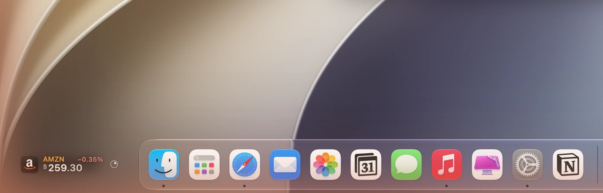
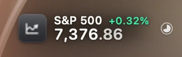
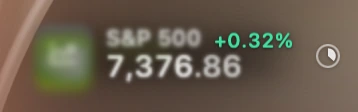
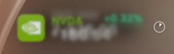
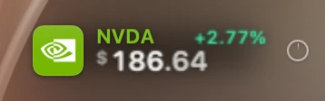
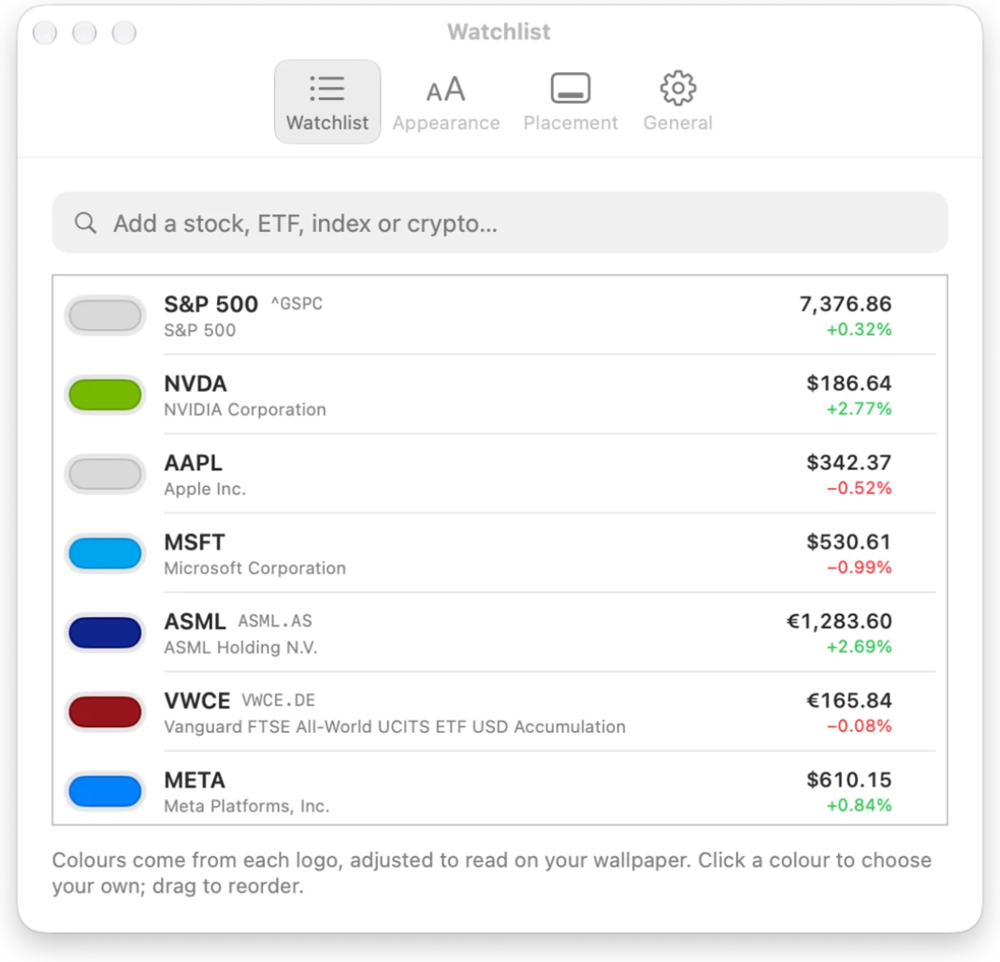
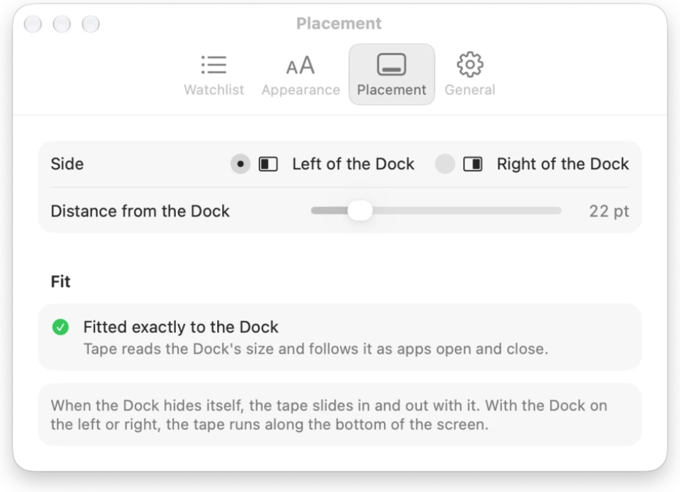

# Tape

[](https://yorben.me/#tape)
[](https://github.com/Yvsleyen00941/homebrew-tap)
[](https://github.com/Yvsleyen00941/Tape/releases)
[](https://github.com/Yvsleyen00941/Tape/stargazers)
[](LICENSE)
[](https://swift.org)
[](https://yorben.me/#tape)

A stock ticker that runs beside the Dock. Your own stocks, ETFs, indices and crypto show up
in the empty corner next to the Dock's glass: names in their logo's colour, prices, and the day's
move in mint or coral. Nothing else is drawn: no bar and no background.



## Install

- **Download** `Tape-macOS-v1.0.0.zip` from [Releases](https://github.com/Yvsleyen00941/Tape/releases/latest),
  unzip it and move Tape to Applications.
- **Homebrew:** `brew install --cask Yvsleyen00941/tap/tape`

Tape needs macOS 26 or later. It isn't notarized, so the first time macOS won't open it: go to
System Settings → Privacy & Security and click Open Anyway. For an exact fit, give Tape
Accessibility access from Settings → Placement: it uses it only to read where the Dock is.
Without it, Tape works the Dock out from the Dock's own preferences.

### Build it

```sh
xcodegen generate
xcodebuild -project Tape.xcodeproj -scheme Tape -configuration Release -derivedDataPath build build
ditto build/Build/Products/Release/Tape.app /Applications/Tape.app && open /Applications/Tape.app
```

Tests (48): `xcodebuild -project Tape.xcodeproj -scheme Tape -derivedDataPath build test`.
Signing uses team `34LM5DW4G4`; another team needs its own bundle identifier.

Tape is a menu bar app with no Dock icon. The menu bar mark (one step up, one live price) and a right-click
on the tape both open its menu. Opening Tape again from Finder or Spotlight brings up Settings.

## Designs

Six looks, switchable live from the menu (Design ▸) or Settings → Appearance. Each one changes
material, colour, type and motion, not just a tint:

| | |
|---|---|
| **Liquid** (default) | A rail of real behind-window glass beside the Dock, each listing in its own capsule, with the move in a tinted chip. |
| **LED** | A 5 × 7 dot-matrix face (drawn by hand, in `LEDFont`) on smoked black over a fixed grid of unlit dots. It moves one dot at a time through a discrete Core Animation keyframe track. |
| **Paper** | Printed ticker tape: cream grained paper that curls at the ends, New York serif names, SF Mono prices, and ink colours. The perforations move with the print. |
| **Aura** | No background. Rounded type with a drop of brand colour, floating in a glow whose colour and strength are the move's (full at 3.5%). |
| **Focus** | No scrolling. One listing at a time, large: its logo as an app-icon tile, its name, its price, the move in a solid mint or coral pill, and the day so far. Every listing shares one grid, so when the next one comes each column stays put and comes into focus on its own (see below). Clear, or on a pane of the Dock's glass. |
| **Classic** | The first version: text only, shadowed like desktop labels. |

`brand/designs.png` shows all six; `Tape -TapeRenderAll <folder>` redraws them. Every design stays
under 0.5% CPU while it runs.

### Focus, in detail

`brand/focus.html` (and `brand/focus.png`) is its design board. Every picture on it was drawn by Tape
itself with `Tape -TapeFocusBoard <folder>`; the motion frames are recordings of the real window.

- **One grid.** Columns are as wide as the widest listing needs: the tile, the name, the price
  (right-aligned, so decimals line up), the pill (one width for all) and the chart. If the strip is
  short, names get shorter first (between words: "Vanguard FTSE…"), then the gaps, then the chart.
  Only then does the chart go.
- **Compact, on a laptop.** A long Dock on a laptop can leave 130 points or less. Focus then turns into
  a small card: the tile beside the ticker and its move, over the price. If that's still too wide, the
  clock goes first, then the type gets a little smaller. Narrowest (a 1512-point screen with seventeen
  Dock icons leaves about 74 points), the tile goes and ticker, price and move stack on three lines,
  which keeps the type a readable size. The tape shows down to 56 points, and a tight strip takes back
  half of the screen's margin. It redraws by itself when the tape moves to another screen or the Dock
  changes size.
- **In the middle of the corner.** A card with room to spare sits halfway between the screen's edge
  and the Dock's glass, never closer to the Dock than the gap you set; vertically it centres on the
  icons. With Accessibility access Tape measures the glass from the Dock's own icons (its list runs
  5 points higher than the glass); without, it works the glass out from the space the Dock keeps.
- **Sharp at 1× and 2×.** Text starts on a whole pixel, and is smoothed the way macOS draws its own
  (following "Use font smoothing when available"); the window sits on whole points; the clock is
  drawn at the screen's resolution; symbols in tiles are drawn from their outlines at their size; and
  the chart averages a day of minutes a pixel column or two at a time, so it reads as a line, not noise.
  The window on screen matches the drawing pixel for pixel. Drawing at 4× and scaling down was tried
  and is no sharper: the screen's own pixels are the limit.
- **Rack focus.** The old listing drifts up and blurs away while the new one rises out of the blur,
  one column at a time, 35 ms apart. A new price only moves the columns that changed, up when it
  rose and down when it fell. With Reduce Motion the columns cross-fade.

  | 0 ms | 115 ms | 217 ms | 424 ms |
  |---|---|---|---|
  |  |  |  |  |
- **The type.** Labels in their brand colour over the company name without its legal form
  ("Microsoft", not "Microsoft Corporation"). The price is in SF Pro Rounded with tabular figures, the
  currency mark hung from the cap height, and the decimals a step quieter.
- **The day.** The chart spans the whole session, so at eleven in the morning the line is a quarter
  of the way along, over a dotted line where the move is measured from. While the market trades, a
  ring breathes out from its end; once it closes, the end is a hollow dot.
- **The countdown.** A small clock face by the Dock sweeps round over the dwell (6 s, adjustable from
  3 to 15). The pointer stops it and it carries on where it was. A bare arc would read as "loading".
- **Legibility.** On the wallpaper, a soft veil behind the grid keeps text readable over a busy
  photograph. On glass the corners are concentric with the tile's (7.2 + 8 = 15.2 pt).
- **Tiles.** A logo is clipped to an app icon's continuous corners with one sheen and a one-pixel rim.
  Without a logo the tile is the listing's colour, or graphite like Tape's icon, with a glyph for an
  index, a currency, a future or Bitcoin, and initials otherwise.

## What it does

- **Beside the Dock, exactly.** With Accessibility access Tape asks the Dock for its frame and
  follows it as apps open and close. Without access it rebuilds the Dock from its own preferences:
  Finder, pinned apps, running and recent apps, folders, the Trash. The constants were measured on
  macOS 27: icons 1.06 tiles apart, dividers half a tile, glass 0.13 tile past the outer icons.
  That estimate came within a few points of a real 1,118-point Dock. Tape is centred on the icons,
  22 pt from the glass (adjustable), left or right. It slides in and out with an auto-hiding Dock,
  and runs along the bottom of the screen when the Dock sits on a side. It stays off full-screen apps.
- **Colours from logos.** A curated table covers the most-watched names (NVIDIA's green, Vanguard's
  red, Bitcoin's orange…). Everything else gets its colour from its logo (Parqet, then Financial
  Modeling Prep): the most vivid hue that covers a real part of it, so a white wordmark on red is red
  and Apple's grey apple is monochrome. Brand colours are made for white paper, so each keeps its hue
  and has its lightness moved (OKLab) into a band that reads on the wallpaper. Any colour can be
  overridden in Settings.
- **Reads on any wallpaper.** Tape samples the wallpaper behind the strip, respecting the desktop's
  fill, fit and stretch settings, and picks light or dark text. Text gets a tight shadow plus a wide
  soft one, like the labels on the desktop.
- **Moves against yesterday's close or today's open.** Yahoo's own reported move is used where it
  exists, so crypto shows the last 24 hours just like Yahoo does. Today's open comes from one chart
  request per listing per session.
- **Costs nothing while it runs.** Every listing is a bitmap layer, redrawn only when its numbers
  change. At cruising speed the strip is a single repeating Core Animation run by the render
  server: 0.1% CPU. A display link takes over only for changes (slowing for the pointer, a listing
  opening up) and stops once the tape is still. It runs at 120 Hz on ProMotion, or 60 in Low Power Mode.
- **Made to be read.** Hover and the tape eases to a stop in half a second and comes to rest on
  whole pixels, so the text is as crisp as the menu bar. The other listings dim to let the one
  under the pointer stand out. Two fingers scrub it by hand. A new price flashes mint or coral and
  fades back. New listings open up room for themselves; removed ones close theirs.
- **Detail on click.** A Liquid Glass card with the logo, full price, the move in both units,
  today's path against the reference line, the day and 52-week ranges, and when the market
  opens or closes in your time zone.

  | Watchlist | Placement |
  |---|---|
  |  |  |

- **Refreshes sensibly.** One batched request for up to 20 symbols every 30 s while any of their
  markets trades (15 s to 5 min, adjustable). When they're all closed it waits for the next opening
  bell. It refreshes on wake, keeps the last prices on disk and shows them instantly at launch.

## Layout

```
Tape/
  App/            entry point, AppModel (wiring), settings, render and screenshot modes
  Market/         quotes, Yahoo Finance client, refresh scheduling, formatting
  Brand/          curated brand colours, logo colour extraction, OKLab and legibility
  Dock/           measuring and estimating the Dock, following it and its auto-hide
  Ticker/         the panel and its placement, the moving tape, Focus, item rendering, wallpaper sampling
  Designs/        the six designs: metrics, renderers, Focus's grid, the LED face, backdrops and the stage
  Detail/         the detail card and its panel
  Settings/       Watchlist, Appearance (with a live preview on your wallpaper), Placement, General
  DesignSystem/   the mark
TapeTests/        Yahoo decoding (real fixture), moves, formatting, colour, logos, placement, rendering
tools/            app icon generator
brand/            identity board and design proposals (open brand/index.html)
```

`Tape -TapeRender <file.png>` draws the tape over the wallpaper behind it and quits (`-TapeScale 1` for 1×,
`-TapeStrip 74` as if the Dock left a strip that wide).
`Tape -TapeFocusBoard <folder>` draws the pictures for Focus's board. Debug builds also take
`-TapeShots <folder>`, which photographs Tape's own windows (no screen-recording permission needed);
add `-TapeShotsAlpha YES` to keep their transparency, to lay them over a real screenshot.
`Tape -TapeDockInfo <file>` writes what Tape knows about the Dock; launch it with
`open -n -a Tape --args …` so it runs with Tape's own Accessibility access.

## Notes and limits

- Yahoo Finance's endpoints are unofficial and can change. Prices can be delayed up to 15 minutes
  on some exchanges.
- Without Accessibility access the Dock is estimated: magnification, unusual spacers or a Dock
  shared across displays can put it a few points off. The distance slider absorbs that.
- With an Aerial (moving) wallpaper, macOS reports a still picture rather than what's on screen,
  so light or dark text is chosen for that still. Contrast in Settings can fix it either way.
- Logos come from third-party services and are cached for 30 days in
  `~/Library/Application Support/Tape/Logos`.

## Also by Yorben

- **[Cockpit](https://github.com/Yvsleyen00941/Cockpit)** — Unified daily productivity HUD and menu bar daemon.
- **[Rime](https://github.com/Yvsleyen00941/Rime)** — Distraction-free reading engine for PDF, EPUB, and Markdown with typography-first continuous layout.
